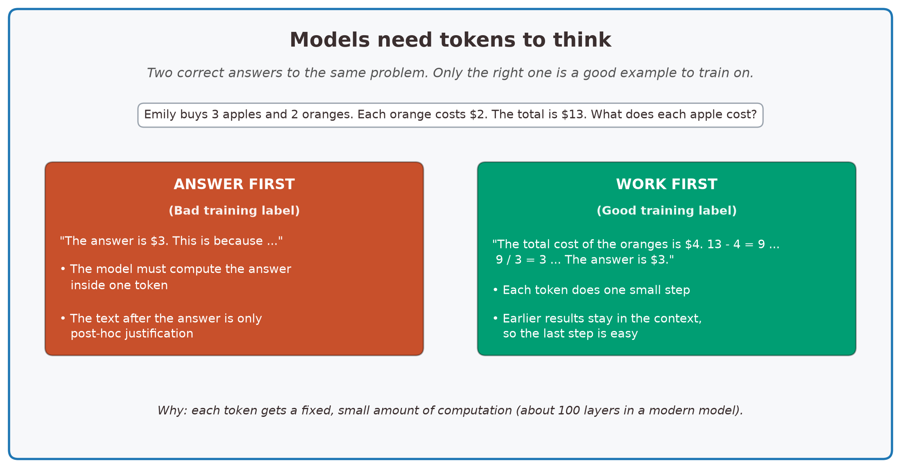

# video-notes-creator

A Claude skill that turns one YouTube video into visual study notes: a web page, its Markdown source, and a `figures` folder.

- The page has a contents bar on the left. When one idea needs several frames, they show as one slider with previous and next buttons. Click any figure to see it full size.

- The figures are the speaker's own slides, taken at the moment each slide is complete. Where no usable slide exists, it draws a card diagram from the concept.
- Each claim has a timestamp and a source tag: [Speaker], [Slide], [Demo], or [Inference].
- Each example says *why* the behavior happens, if the speaker explains it.
- Resources are numbered and clickable. A citation `[3]` jumps to its row, and each row links back to the sections that use it.
- It never downloads the video.



*A generated card diagram from a test run. It was drawn where the talk had no slide for the idea. Content from Andrej Karpathy, "Deep Dive into LLMs like ChatGPT" [1:46:56 to 1:53:13].*

## The problem

A video's best visuals are its slides. Getting them is expensive in two ways:

1. **Bandwidth.** Downloading a 3.5-hour talk at 1080p is about 557 MB, only to keep 20 frames.
2. **Tokens.** A model that looks at frames to find slides pays for every image it opens. In the first version, finding slides was the largest share of the cost: 36% of about 1.2 million effective tokens for one PDF.

The first version also used Mermaid diagrams for every idea. They were technically correct and hard to read. The fix was a rule: use the speaker's slide first, and draw a diagram only when no slide exists.

## How it finds slides without a download

[`scripts/slide_tools.py`](scripts/slide_tools.py) has three commands: `transcript`, `scan`, and `grab`.

**`scan`** reads the smallest video stream (240p) once and looks at one frame every 2 seconds:

- YouTube throttles one long request, so the script fetches the stream in 8 MB HTTP Range chunks, as a player does, and pipes them into ffmpeg. Nothing is saved to disk.
- Frames that show the same picture are merged into a run. The script keeps the **last** frame of each run, where a slide's build animation is complete.
- A slow change (a zoom, a growing wave, an animated diagram) differs little from one frame to the next. So the script also compares each frame with the first frame of its run, at 64x36 in grey. When the difference reaches 3 levels, a new run starts. The middle states of an animation are then candidates too.
- Typing in a screen recording changes even less: a still editor gains one line at a time. In a still picture, a drift of 1.2 levels starts a new run, at the next moment when the screen holds still. Boxes that move in most frames, such as a webcam or a playing video, do not count. So a webcam corner cannot split a slide.
- Each picture gets two measures that ignore colour. **Still:** at least 80% of its 48 boxes (8 x 6) do not change between frames, so a webcam corner cannot make a slide look moving. **Flat:** its most common shade covers at least 35% of it, as a slide background does in any colour.
- Still and flat is a slide. Moving and not flat is a camera shot, and it is dropped. One of the two is "check by eye": slides with video inside, zooming paper pages, a speaker in front of a plain wall. The sheets mark these with an amber "check".
- The sheets show the complete state of each change first, slides before "check by eye". The middle states of animations come after, so typing in a screen recording cannot push whole screens off the sheets.
- The output is a few contact sheets plus `inventory.txt`. The model looks at the sheets once and selects the slides it needs.

**`grab`** gets only the selected frames at 1080p. ffmpeg seeks inside the remote stream, so it reads about 0.3 to 2 MB per frame, not the full file. Each frame is compared with its scan tile. If the time is off, the script searches nearby offsets until the frame matches.

If the stream cannot be read, `scan` falls back to YouTube's storyboard thumbnails: one picture each 10 seconds, about 1 MB for a 40-minute video.

## Measured results

From three test runs (a 39-minute talk, a 3.5-hour lecture, and a 30-minute interview):

| Measure | Result |
|---|---|
| Data read for the dense scan of 3:31:23 | 42.5 MB at 240p (the 1080p file is 557 MB) |
| Time for that scan | 36 seconds |
| Data read for 26 full-resolution frames (3.5-hour lecture) | 10.4 MB |
| Data read for the dense scan of a 29:49 interview / 9 frames at 1080p | 22.7 MB / 14.1 MB (the 1080p file is 311 MB) |
| Slide pictures lost, 8 hand-labelled videos (471 in total): colour test / still and flat | 96 / 8 |
| Hand-picked frames of an animated math video found as candidates: before / after the drift split | 4 / 14 of 14 |
| Frames that matched their scan tile on the first try | 25 of 26 |
| Storyboard fallback, 39-minute talk | 0.9 MB for the full video |
| Storyboard frames correct before tile matching / after | 5 of 10 / 10 of 10 |
| Images the model opened to find and confirm slides (3.5-hour video) | 4 |

The token figures are from one session transcript, weighted as: input 1, cache read 0.1, cache write 2, output 5. I did not run a like-for-like token comparison of the old and new workflow.

## Before each run

The skill asks for two things, unless your request already gives them:

1. **Reader profile**: role, level in the topic, what you already know, and your goal. The notes explain only what you do not know.
2. **Output path**: the folder for the notes. Each video gets its own subfolder.

To skip the question each time, copy `reader-profile.example.md` to `reader-profile.md` in this folder and edit it. The skill shows it and asks you to confirm. `reader-profile.md` is in `.gitignore`.

## Install

**Claude Code, from the marketplace** (see the [repository README](../../README.md)):

```
claude plugin marketplace add ashishkkumar-dev/claude-skills
claude plugin install video-notes-creator@atease
```

**Claude Code, by hand**: copy this folder to `~/.claude/skills/` (all projects) or to `.claude/skills/` in one project.

**claude.ai**: zip this folder and upload it as a skill. Code execution must be on. The sandbox may not reach YouTube. Then the skill asks you to paste the transcript and draws its own diagrams.

## Requirements

Python 3.10 or later, and the packages in [`requirements.txt`](requirements.txt). You also need `ffmpeg` on the path, or the `imageio-ffmpeg` package. The skill installs the packages in a virtual environment if they are missing.

## Use

After a marketplace install, the skill's name includes the plugin name:

```
/video-notes-creator:video-notes-creator https://www.youtube.com/watch?v=<id>
```

If you copied the folder by hand, use `/video-notes-creator`. You can also just ask Claude to "make study notes for <link>".

You can give the profile and the path in the same request:

```
/video-notes-creator:video-notes-creator https://www.youtube.com/watch?v=<id> Reader: product manager, new to ML. Save to ~/Documents/video-notes
```

The scripts also work on their own, from this folder:

```
python scripts/slide_tools.py transcript <url> work/
python scripts/slide_tools.py scan <url> scan/
python scripts/slide_tools.py grab <url> figures/ --match scan/tiles 12:34 1:02:05
python scripts/build_html.py notes.md notes.html
```

## Files

| File | What it does |
|---|---|
| `SKILL.md` | The instructions that Claude follows |
| `scripts/slide_tools.py` | `transcript` gets the transcript and video details. `scan` finds slide candidates without a download. `grab` gets selected frames at full resolution |
| `scripts/build_html.py` | Builds the web page from the notes Markdown: contents bar, sliders, full-size view, clickable citations. Warns about missing images, broken links, and long sentences |
| `reader-profile.example.md` | Template for a saved reader profile |
| `tests/` | Unit tests for both scripts. They need no network |

## Tests

From the repository root:

```
pip install pytest -r skills/video-notes-creator/requirements.txt
python -m pytest skills/video-notes-creator/tests
```

The tests cover the logic that is easy to get wrong:

- merging frames into runs and keeping the last frame
- splitting a slow animation into several runs, and typing at its pauses, but not a still slide with a moving webcam corner
- sorting pictures into slide, camera shot, and check by eye, for white, black, navy, yellow, and green slides
- showing whole screens on the sheets before the middle states of animations, and grouping the transcript by minute
- the one-step offset of storyboard tiles
- citation, anchor, and link conversion
- figure runs that become sliders, nested lists, and code blocks
- an end-to-end page build that warns about missing images, broken links, and long sentences

## Limits

- YouTube only. Other sites need a manual transcript, and the skill asks before it downloads anything.
- The contact sheets show 144 candidates at most: slides first, then the longest held. A candidate that is not on a sheet is still listed in `inventory.txt`.
- Stream access depends on `yt-dlp` and can break when YouTube changes.
- The notes quote and show the speaker's material. Keep them for personal study, and respect the video's license and YouTube's terms. Do not publish notes that contain slide screenshots without permission.

## License

MIT. See [LICENSE](../../LICENSE). See [CHANGELOG.md](CHANGELOG.md) for versions.
